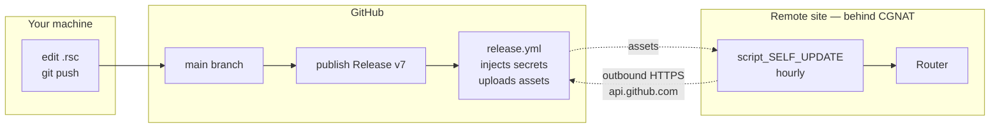

# routeros-gitops

**Deploy MikroTik RouterOS config from a GitHub repo — to routers you cannot reach.**

The router polls GitHub. GitHub never touches the router.

That inversion is the entire idea, and it is what makes this work behind CGNAT,
behind an ISP box you don't control, at a customer site with no port-forward, on
an LTE uplink — anywhere inbound SSH is impossible. Outbound HTTPS traverses
every NAT there is.

Every piece here has been through a production deployment. The comments explain
*why*, including the parts that caused outages.

---

## Table of contents

- [The problem](#the-problem)
- [How it works](#how-it-works)
- [What you get](#what-you-get)
- [⚠️ Read this before you publish anything](#️-read-this-before-you-publish-anything)
- [Quick start](#quick-start)
- [Repository layout](#repository-layout)
- [Daily use](#daily-use)
- [Many routers: engine as a submodule](#many-routers-engine-as-a-submodule)
- [Documentation](#documentation)
- [Is this for you?](#is-this-for-you)

---

## The problem

You want your router's configuration in Git: reviewed, versioned, rolled back
like code. The obvious design is a CI job that SSHes into the router and runs
`/import`.

That design breaks the moment the router is somewhere real:

| Situation | Why push-based CI fails |
|---|---|
| CGNAT mobile/LTE uplink | No public IP exists to connect to. At all. |
| ISP-supplied fiber box | You cannot add a port-forward; the customer won't either. |
| Customer / remote site | Nobody on site to open a firewall, and you shouldn't ask. |
| Dynamic IP | The address CI knew is wrong by the time it runs. |
| Security review | An SSH key in CI that reaches production is a standing liability. |

The workaround people reach for is a VPN overlay (ZeroTier, Tailscale,
WireGuard). That works — until you meet a router that can't run it. MIPS-based
MikroTik hardware (hEX, hAP, most of the cheap useful ones) has no ZeroTier
package. Now you're maintaining a jump host to manage a €60 router.

**So stop pushing. Let the router pull.**

## How it works



1. You edit `.rsc` files and push to `main`. **Nothing deploys.**
2. You publish a GitHub **Release**. That is the deliberate act.
3. `release.yml` renders each script — substituting your secrets — and attaches
   the results to the release. **It never contacts a router.**
4. Every router polling this repo notices the new tag within the hour,
   downloads the assets over plain outbound HTTPS, and imports them itself.
5. If the new config breaks WAN, the router restores its own pre-deploy backup
   and reboots. Unattended. Without you.

**To roll back, publish a release pointing at an older commit.** The router
converges to it next hour. Same mechanism, no router access, no drama.

## What you get

**The engine** — the part you keep:

| File | What it does |
|---|---|
| `engine/99-self-update.rsc` | The pull agent. Polls, fetches, verifies, imports, verifies WAN, commits or rolls back. |
| `engine/02-watchdog.rsc` | Boot-time safety net. Deploy broke routing? Restore and reboot, automatically. |
| `engine/01-pre-deploy-snapshot.rsc` | Makes the rollback target before every apply. Retention-managed. |
| `engine/00-observability.rsc` | Structured JSON events + a dead-man's switch, so silence becomes an alert. |
| `engine/10-maintenance.rsc` | Nightly RouterOS + firmware updates. Reboots only when an update needs it. |
| `deploy-manifest.json` | The ordered apply list. One source of truth for CI, the router, and local deploys. |
| `scripts/render.sh` | The single secret-injection engine. CI and local deploy both call it, so they cannot drift. |

**Example config** — the part you replace:

`config/10-network.rsc` (LAN + isolated guest network, firewall, NAT, queue),
`config/30-backup.rsc` (backups + retention).

They are working, deployable examples that encode ordering rules you would
otherwise learn by locking yourself out. Read them, then make them yours.

**Safety properties**, in the order they protect you:

- **Fetch-all-then-import.** Every asset lands on disk and is verified non-empty
  *before* the first `/import`. A partially-uploaded release cannot half-apply.
  (This exists because it once did: a cleanup module imported, the module that
  rebuilds the config 404'd, and the WiFi was gone for an hour.)
- **Pre-deploy snapshot** taken automatically, three kept.
- **Inline WAN check** after apply → restore + reboot on failure.
- **Boot watchdog**: 20 × 15s checks, 3 consecutive failures → restore + reboot.
- **Confirmed-good backup** saved only after five clean minutes.
- **Idempotent modules** — every file removes before it adds, so re-import
  converges instead of duplicating.

---

## ⚠️ Read this before you publish anything

**Your deployment repo must be PRIVATE.**

Release assets are rendered with your real secrets in cleartext — that is how
the router receives them. On a public repository, release assets are
downloadable by anyone with no authentication. Publishing a release from a
public repo publishes your credentials to the internet.

*This template repo is public because it contains no secrets. Your fork of it,
with your config and your GitHub Actions secrets, must not be.*

Both `release.yml` and `bootstrap.sh` refuse to run against a public repository.
Do not remove those checks.

Two further rules:

- **Scope the PAT to nothing.** Fine-grained, this repository only,
  `Contents: Read-only`. It sits in cleartext in a script on the router and in
  every release asset. Treat it as already leaked.
- **Never commit `scripts/.env`.** It is gitignored. Keep it that way.

---

## Quick start

**You need:** a MikroTik router on RouterOS 7, `gh` (authenticated), `jq`, and
about twenty minutes.

```bash
# 1. Make YOUR OWN PRIVATE repo from this template.
gh repo create my-network-config --private --clone \
  --template <owner>/routeros-gitops
cd my-network-config

# 2. Credentials.
cp scripts/.env.example scripts/.env
$EDITOR scripts/.env          # GITOPS_GITHUB_REPO + GITOPS_GITHUB_PAT are required

# 3. Adapt the example config to your site. Do not skip this —
#    10-network.rsc will renumber your LAN to 10.1.1.0/24 as shipped.
$EDITOR config/10-network.rsc

# 4. Provision the router and push secrets to GitHub. One time, on the LAN.
./scripts/bootstrap.sh --ip 192.168.88.1
./scripts/deploy-local.sh --ip 10.1.1.1

# 5. Ship the router. From here on it is remote-managed with no inbound access.
git add -A && git commit -m "initial config" && git push
gh release create v1 --generate-notes
```

Full walkthrough with verification at each step: **[docs/02-setup.md](docs/02-setup.md)**.

## Repository layout

```
routeros-gitops/
├── deploy-manifest.json          ORDERED apply list — the source of truth
├── secrets.map                   placeholder -> env var table (names only)
│
├── engine/                       the pull-deploy machinery
│   ├── 00-observability.rsc      log events, heartbeat, dead-man's switch
│   ├── 01-pre-deploy-snapshot.rsc  rollback target maker
│   ├── 02-watchdog.rsc           boot-time auto-rollback
│   ├── 10-maintenance.rsc        updates; reboot only when an update needs it
│   └── 99-self-update.rsc        the pull agent (imported last, on purpose)
│
├── config/                       YOUR config — examples to replace
│   ├── 10-network.rsc            LAN + isolated guest, firewall, NAT, queue
│   └── 30-backup.rsc             weekly backup + retention
│
├── scripts/
│   ├── render.sh                 THE secret-injection engine (CI + local)
│   ├── build-release.sh          manifest -> rendered release assets (CI + local)
│   ├── bootstrap.sh              one-time router + GitHub provisioning
│   ├── deploy-local.sh           LAN deploy, for provisioning only
│   └── .env.example
│
├── .github/workflows/release.yml render + attach assets. Never touches a router.
└── docs/
```

Numeric prefixes make apply order visible at a glance, but `deploy-manifest.json`
is what actually decides. Order matters: observability installs `script_LOG_EVENT`
that everything else calls; the self-update agent goes **last** so a broken
release can still be replaced by the next one.

## Daily use

```bash
# Change something
$EDITOR config/10-network.rsc
git commit -am "guest: cap at 50M" && git push     # nothing deployed yet

# Deploy
gh release create v8 --generate-notes              # every router converges within the hour

# Roll back
gh release create v9 --target <older-sha> --generate-notes
```

**Do not hand-edit a deployed router**, even when you are standing next to it
on the LAN. The next hourly pull re-imports the manifest and silently reverts
you — the change looks fixed and un-fixes itself within the hour. It also
bypasses the snapshot, the watchdog and the audit trail. Ship a release.

Impatient? [Force an immediate pull](docs/04-operations.md#forcing-an-immediate-pull)
— and read that section first, because deleting the one-shot scheduler too
early kills the running import mid-apply. That has caused a real outage.

## Many routers: engine as a submodule

Forking this template once per router works, until you fix a bug in the
engine and have to copy the fix into every fork by hand. Forks drift.

The alternative: **one private repo per router, with this repo as a git
submodule at `gitops/`**, pinned to a tag.

```
my-router-config/                 PRIVATE, one per router
├── gitops/                       submodule -> routeros-gitops @ v1.x
├── config/*.rsc                  this router's config
├── deploy-manifest.json          engine paths are gitops/engine/...
├── secrets.map                   only this router's extra secrets/settings
└── .github/workflows/release.yml copied unchanged from gitops/
```

- The engine is fixed once, here. Each router picks the fix up by bumping the
  submodule — a reviewed commit and a release, never a surprise.
- An old router can stay on an older engine tag until the new one has been
  tested on similar hardware.
- One PAT and one secret set per router: a leaked token exposes one site.
- `render.sh` reads both maps; a site line overrides an engine line with the
  same placeholder (e.g. `PLACEHOLDER_WAN_PING_TARGETS`).
- `release.yml` hands all repo secrets and variables to `render.sh` as JSON,
  so a router-specific secret needs only a `secrets.map` line and
  `gh secret set`, not a workflow edit.

Keep the engine free of anything model- or site-specific: WiFi, WAN layout,
CAPs, firewall belong in the router repo. The engine uses only commands that
work on the oldest RouterOS you run.

## Documentation

| | |
|---|---|
| **[01 — How it works](docs/01-how-it-works.md)** | The design, the state machine, why each safety net exists |
| **[02 — Setup](docs/02-setup.md)** | Full first-time walkthrough with verification steps |
| **[03 — Writing modules](docs/03-writing-modules.md)** | Adding your own `.rsc`, the idempotency contract, secrets |
| **[04 — Operations](docs/04-operations.md)** | Ship, roll back, force a pull, recover a half-applied deploy |
| **[05 — Troubleshooting](docs/05-troubleshooting.md)** | Symptom → cause → fix |
| **[06 — RouterOS gotchas](docs/06-routeros-gotchas.md)** | Scripting traps that cost real downtime |

## Is this for you?

**Yes, if** your routers are behind NAT you don't control, you manage more than
one site, you want config review and rollback, or you've ever been locked out
by a firewall rule you deployed yourself.

**Probably not, if** you have one router on your desk with a public IP and
inbound SSH. Push-based CI is simpler; use that.

**Trade-offs, stated honestly:**

- **Up to an hour of latency** between publishing and applying. Tunable, and
  forceable, but it is the cost of not having inbound access.
- **Secrets are in release assets in cleartext.** Mitigated by a private repo
  and a read-only single-repo PAT, but it is a real property of the design.
- **The router needs outbound HTTPS to `api.github.com`.** If you firewall
  egress, allow it.
- **A broken `.rsc` can still hurt.** The watchdog catches loss of WAN. It does
  not catch a config that keeps WAN up while breaking your WiFi — one real
  outage came from exactly that. Probe unfamiliar syntax on a live box before
  putting it in a release; see [docs/06](docs/06-routeros-gotchas.md).

---

## Contributing

Issues and PRs welcome — especially gotchas you hit on hardware not covered
here. If you're adding a workaround, please say which RouterOS version and
model you saw the behaviour on. Half the value of this repo is in the comments
explaining why something is the way it is.

## License

MIT — see [LICENSE](LICENSE).

Not affiliated with or endorsed by MikroTik. RouterOS and MikroTik are
trademarks of Mikrotikls SIA.
